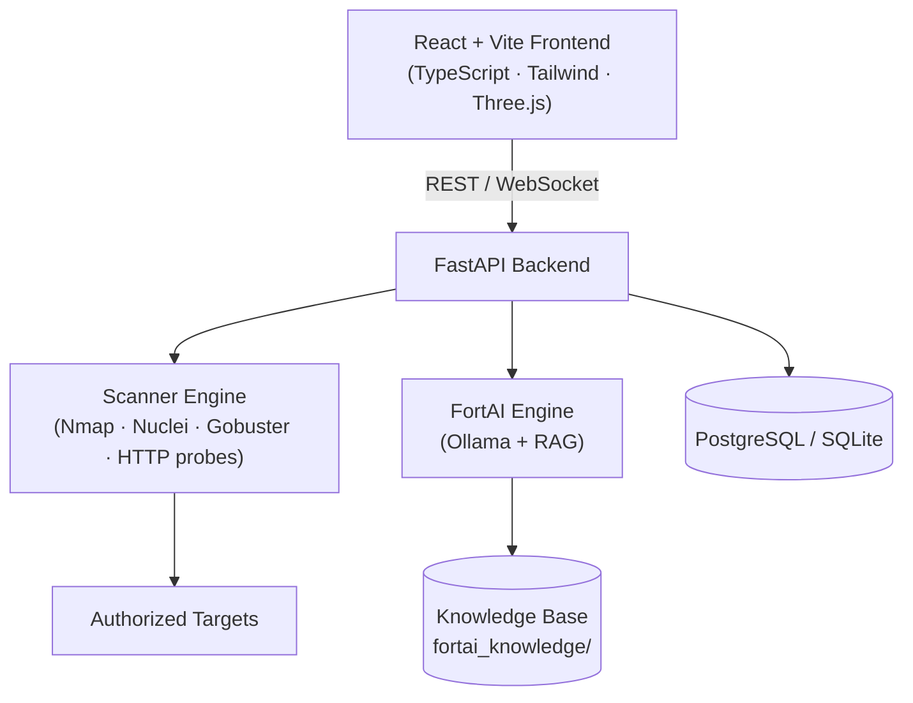

<div align="center">

# 🛡️ FORT

### Cyber Fortification & Reconnaissance Toolkit

**Scope-enforced vulnerability scanning with a private, local AI security analyst.**

[](LICENSE)


</div>

> ⚠️ **Legal notice:** FORT is intended **only** for education, defensive security, and **authorized** penetration testing within an approved scope. Scanning systems you do not own or have explicit written permission to test is illegal. You are solely responsible for how you use this tool.

---

## 📖 Overview

**FORT** is an automated security assessment and vulnerability management platform for security teams, penetration testers, and DevSecOps engineers. It wraps industry-standard scanners (**Nmap**, **Nuclei**, **Gobuster**) behind a web dashboard and adds **FortAI**, a local Retrieval-Augmented Generation (RAG) analyst powered by **Ollama**, so findings can be analyzed in context without sending data to external AI APIs.

<!-- TODO: Add a screenshot or demo GIF here. This is the single most effective improvement for the README.
<p align="center">
  
</p>
-->

## 📑 Table of Contents

- [Key Features](#-key-features)
- [Screenshots](#-screenshots)
- [Architecture](#-architecture)
- [Tech Stack](#-tech-stack)
- [Quick Start](#-quick-start)
- [First Run](#-first-run)
- [Configuration](#-configuration)
- [Testing](#-testing)
- [Security & Scope Policy](#-security--scope-policy)
- [Repository Structure](#-repository-structure)
- [Roadmap](#-roadmap)
- [Contributing](#-contributing)
- [License](#-license)
- [Disclaimer](#-disclaimer)

## 🌟 Key Features

| Feature | Description |
| --- | --- |
| 🌐 **Scope Management** | Define projects, IP ranges, and domains. Target validation guards block scans against anything outside the active scope. |
| ⚡ **Automated Scanning** | Integrated Nmap, Nuclei, Gobuster, and custom HTTP probing modules, with job tracking and progress monitoring. |
| 🤖 **FortAI (Local RAG)** | A security analyst engine running on Ollama with a cybersecurity knowledge base for contextual risk evaluation. Designed to keep scan data on your machine. |
| 📊 **Live Dashboard** | React UI with real-time telemetry, per-target risk scoring, and interactive 3D visuals built with Three.js. |
| 📑 **Reporting** | One-click, audit-ready PDF reports covering findings, CVE enrichment, and prioritized remediation. |
| 🔐 **Access Control** | Role-based authorization, JWT authentication, and database migration scripts that support audit trails. |

## 🖼️ Screenshots

<!-- Replace these placeholders with real images stored in docs/images/ -->

| Dashboard | Findings | FortAI Chat |
| --- | --- | --- |
| _coming soon_ | _coming soon_ | _coming soon_ |

## 🏗️ Architecture



**How a scan flows:** a user creates a project and defines its scope → requests a scan → the backend validates every target against that scope → scanner adapters run the tools and collect results → findings are stored, scored, and optionally analyzed by FortAI → results appear on the dashboard and in PDF reports.

## 🛠️ Tech Stack

**Backend**
- Python 3.11+ with FastAPI
- SQLAlchemy ORM, PostgreSQL or SQLite
- SQL migration scripts (see `database/`)
- Background job processing for scans
- Nmap, Nuclei, Gobuster, and custom HTTP probes

**Frontend**
- React 18, TypeScript, Vite
- Tailwind CSS and Lucide Icons
- Three.js for 3D visualizations

**AI**
- Ollama for local model hosting
- Custom RAG pipeline over Markdown security guides in `backend/fortai_knowledge/`

## 🚀 Quick Start

### Prerequisites

- Docker and Docker Compose
- Node.js 18+ (manual setup only)
- Python 3.11+ (manual setup only)
- [Ollama](https://ollama.com) (optional, required for FortAI)
- Nmap, Nuclei, and Gobuster installed and on your `PATH` (manual setup only)

### Option 1: Docker (recommended)

```bash
# 1. Clone the repository
git clone https://github.com/Chaitanya-Kanawade/FORT.git
cd FORT

# 2. Create your environment file
cp backend/.env.example backend/.env

# 3. Generate a strong secret and put it in backend/.env as SECRET_KEY
openssl rand -hex 32

# 4. Build and start all services
docker-compose up --build -d
```

| Service | URL |
| --- | --- |
| Frontend UI | http://localhost:3000 |
| Backend API docs (Swagger) | http://localhost:8000/docs |

### Option 2: Manual local setup

**Backend**

```bash
cd backend

# Create and activate a virtual environment
python -m venv venv
source venv/bin/activate        # Windows: venv\Scripts\activate

# Install dependencies
pip install -r requirements.txt

# Create your environment file
cp .env.example .env

# Apply the database schema
sqlite3 fort.db < ../database/MASTER_MIGRATION_V1.sql

# Start the API server
uvicorn app.main:app --reload --port 8000
```

**Frontend**

```bash
cd frontend
npm install
npm run dev
```

> The Vite dev server usually runs at **http://localhost:5173** (not port 3000, which is used by the Docker setup). Check your terminal output for the exact address.

## 🧭 First Run

1. **Start Ollama and pull a model** (needed for FortAI):
   ```bash
   ollama serve
   ollama pull llama3
   ```
2. **Open the app** and sign in or register. <!-- TODO: document how the first admin user is created (seed script, default credentials, or first-user-is-admin). -->
3. **Create a project** and add your authorized targets to its scope.
4. **Launch a scan** against an in-scope target and watch progress on the dashboard.
5. **Open FortAI** to ask questions about your findings, then **generate a PDF report**.

## ⚙️ Configuration

All options live in `backend/.env` (see `backend/.env.example` for the full list).

| Variable | Description | Default / Example |
| --- | --- | --- |
| `PROJECT_NAME` | Platform name | `FORT` |
| `SECRET_KEY` | JWT signing secret. **Must be changed.** | `openssl rand -hex 32` |
| `DATABASE_URL` | Database connection string | `sqlite:///./fort.db` |
| `OLLAMA_BASE_URL` | Local Ollama instance URL | `http://localhost:11434` |
| `FORTAI_MODEL` | LLM used for security analysis | `llama3` |

> 🔑 Never commit `.env`, database files, or scan output to version control.

## 🧪 Testing

```bash
# Backend tests
cd backend
pytest

# Windows quality and health checks (PowerShell)
.\scripts\run_quality_checks.ps1
```

## 🔒 Security & Scope Policy

FORT is built so that it is harder to misuse:

- **Scope enforcement:** scans can only run against domains and IPs explicitly authorized in an active project scope.
- **Input sanitization:** scanner adapters parse and strip invalid target specifications before invoking external binaries (`nmap`, `nuclei`, `gobuster`).
- **Authentication:** JWT-based auth with role-based access control.
- **Local AI:** FortAI is designed to run on a local Ollama instance so scan data stays on your infrastructure.

**Reporting a vulnerability:** please do **not** open a public issue. Contact the maintainer privately (add a `SECURITY.md` or a contact email here).

**Hardening tips for deployment:**
- Set a unique, random `SECRET_KEY`.
- Run FORT behind HTTPS and restrict network access to trusted users.
- Run scanners from an isolated network segment.
- Treat scan output sent to the LLM as untrusted input.

## 📂 Repository Structure

```text
FORT/
├── backend/                  # FastAPI backend
│   ├── app/
│   │   ├── ai/               # Risk engine & AI scoring
│   │   ├── api/              # API routes (recon, scans, reports, ...)
│   │   ├── core/             # Config, security, middleware
│   │   ├── crud/             # Database operations
│   │   ├── models/           # SQLAlchemy models
│   │   ├── scanner/          # Scanner adapters (Gobuster, Nuclei, Nmap)
│   │   ├── schemas/          # Pydantic schemas
│   │   └── services/         # Business logic & FortAI RAG engine
│   ├── fortai_knowledge/     # Markdown knowledge base for RAG
│   ├── tests/                # Pytest suites
│   └── requirements.txt
├── frontend/                 # React + Vite frontend
│   ├── public/
│   └── src/
│       ├── components/       # Modals, panels, Three.js scene
│       ├── pages/            # Dashboard, Findings, FortAI, Reports
│       ├── services/         # API integration layer
│       └── types/            # TypeScript types
├── database/                 # SQL master & migration scripts
├── docker/                   # Dockerfiles & Nginx configs
├── docs/                     # SRS, architecture & manuals
├── scripts/                  # Test & utility scripts
├── docker-compose.yml
└── README.md
```

## 🗺️ Roadmap

- [ ] Add screenshots and a demo GIF
- [ ] CI pipeline (tests + frontend build) with GitHub Actions
- [ ] Cross-platform quality-check script (`Makefile` or `.sh`)
- [ ] Domain ownership verification before scanning
- [ ] Additional scanner integrations
- [ ] Scheduled and recurring scans
- [ ] Export findings to JSON / SARIF

## 🤝 Contributing

Contributions are welcome!

1. Fork the repository
2. Create a branch: `git checkout -b feature/your-feature`
3. Commit your changes: `git commit -m "Add your feature"`
4. Push the branch: `git push origin feature/your-feature`
5. Open a Pull Request

Please make sure tests pass before submitting. Bug reports and feature ideas are welcome in [Issues](https://github.com/Chaitanya-Kanawade/FORT/issues).

## 📄 License

Distributed under the **MIT License**. See [`LICENSE`](LICENSE) for details.

## ⚠️ Disclaimer

This tool is provided for **educational purposes, defensive security, and authorized penetration testing** only. The authors and contributors accept no liability for misuse or damage. Always obtain explicit written permission before testing any system you do not own.

---

<div align="center">

Built by [Chaitanya Kanawade](https://github.com/Chaitanya-Kanawade) · If you find FORT useful, consider giving it a ⭐

</div>
